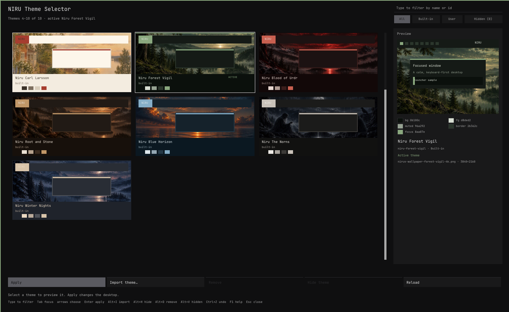

# NIRU Theme Selector

Theme browser with live desktop previews for the NIRUX X11 desktop.

**Status: beta** · Part of the [NIRUX](https://github.com/nirucon/nirux) suite · [MIT License](LICENSE)



## About

NIRU Theme Selector (`niruthemeselector`) is a native Rust theme browser for
NIRUX. It shows each theme as a small desktop preview with its wallpaper, bar,
window frame and palette. Selecting a card only changes the preview; **Apply**
uses the existing `niructl` theme path, so NIRUX settings, NIRU Launcher and the
NIRUWM theme path remain the source of truth.

Themes can also be installed from the
[`nirux-theme-*`](https://github.com/nirucon?tab=repositories&q=nirux-theme)
packs; they appear here as user themes.

## Features

- Responsive grid of theme cards with wallpaper thumbnails and palette
  swatches, with the visible range and total (themes 1 to 9 of 23, for
  example) in the header and a scrollbar you can click or drag.
- A larger preview with a bar, focused window and launcher sample, the
  palette's hex values, the wallpaper's file name and resolution, the full error
  text of an invalid theme, and the other themes of the same family.
- Type to filter by name or id; filter chips **All · Built-in · User ·
  Hidden (n)**.
- Apply with `Enter`, a double-click or the Apply button. For 15 s afterwards,
  **Undo** (or `Ctrl+Z`) re-applies the theme that was active before.
- Import a theme TOML plus an optional PNG wallpaper, with paste, an in-app
  **Browse…** list and a check of both paths and the theme's name and palette
  before anything is imported. Remove user themes; hide or show bundled
  themes. Disabled buttons say why.
- Switch the wallpaper style for every theme with `Alt+S` or a click on
  **Wallpaper: Art** at the right of the key hints: **Art** shows each theme's
  own artwork, **Signature** the NIRUX photo tinted in the theme's colours
  (a theme without a Signature picture keeps its artwork).
- A compact one-column layout when the window is tiled smaller than 900×620,
  down to 520×420.
- Honest wallpaper fallback: a theme without its image uses its background
  colour.
- Background thumbnail decoding and a bounded disk/memory cache. No daemon and
  no network access while browsing; an idle window starts no process.

## Requirements

- X11 and a NIRUX session (`niructl` from NIRUWM).
- Debian, Arch and Void glibc, x86_64. No GTK, Qt, Electron or WebView runtime.

## Installation

### With NIRUX

NIRU Theme Selector is a core component: `nirux install` and `nirux update`
install and update it from the pinned manifest, with its desktop entry and
icon. Open it from NIRU Launcher or run `niruthemeselector`.

### Standalone

For development, after `cargo build --release`:

```sh
./install.sh    # installs to ~/.local (NIRUTHEMESELECTOR_PREFIX or NIRUX_PREFIX override)
```

It installs `bin/niruthemeselector`, the desktop entry and the icon, and still
needs NIRUWM's `niructl` at run time.

## Usage

```sh
niruthemeselector              # open the window (also: niruthemeselector open)
niruthemeselector status       # active theme and catalogue
niruthemeselector list         # available themes
niruthemeselector --version
niruthemeselector --help
```

| Key | Action |
|---|---|
| Typing | Filter the grid by name or id |
| `Esc` | Clear the filter; with no filter, close the window |
| `Tab` / `Shift+Tab` | Move between cards, actions, filter chips and the wallpaper style |
| Arrows, `PageUp` / `PageDown`, `Home` / `End` | Choose a theme (only the preview changes) |
| `Enter` | Apply the selected theme, or press the focused control |
| `Space` | Press the focused control (adds a space once a filter is typed) |
| Double-click | Apply a card |
| `Ctrl+Z` | Undo the last apply (15 s) |
| `Alt+A` / `Alt+I` / `Alt+H` / `Alt+D` | Apply / import / hide-show / remove |
| `Alt+V` | Show the hidden themes (the Hidden chip) |
| `Alt+R` | Reload the catalogue |
| `Alt+S` | Switch the wallpaper style between Art and Signature |
| `Ctrl+Q` / `Alt+Q` | Close |
| `F1` | Help |

Single letters type into the filter, so the 0.1 shortcuts (`A`, `I`, `H`, `D`,
`V`, `R`, `Q`) moved to `Alt`+letter. Shortcuts match the key's base symbol, so
they work on every layout. Text input follows the keyboard layout: Shift, AltGr
(`$` and `@` on a Swedish keyboard), Caps Lock and dead keys, which type their
literal accent (`~`, `^`, `` ` ``, `´`, `¨`). The key table is read again when
the layout changes.

### Import and removal

Import accepts the NIRUX TOML theme format. An optional PNG wallpaper is copied
beside the other NIRUX theme wallpapers and recorded with the user theme;
`niructl theme-import` accepts PNG only, so another format is refused in the
form with that reason. In the fields:

| Key | Action |
|---|---|
| `Ctrl+V` / `Shift+Insert` | Paste the clipboard |
| `Ctrl+B` | **Browse…** (starts in `~/Downloads`; shows only folders and `.toml` or `.png` files) |
| `Ctrl+R` | Toggle replacing a user theme with the same id |
| `Enter` | Import |

User themes can be removed; bundled themes can only be hidden. Removing or
hiding the active theme is refused until another theme is applied. Imported
theme files are data and are never executed.

### Wallpaper style

The footer shows the current style, **Wallpaper: Art** or **Wallpaper:
Signature**. `Alt+S` (or a click on it, or `Enter` when it has the focus) runs
`niructl wallpaper style toggle`, which saves `[wallpaper] theme_style` in
NIRUWM's configuration and reloads the running WM, then reads the catalogue
again so the cards show the new pictures. It is the same setting as
`niructl wallpaper style art|signature`. A niructl from before the setting
shows Art and answers the switch with a short "update NIRUX" message.

## Configuration

There is no configuration file of its own: themes, user themes and the hidden
list live in NIRUWM's configuration directory and are changed through
`niructl`. External changes (`niructl theme X` in a terminal, the hidden list,
a new user theme, a theme wallpaper) are noticed through inotify, debounced by
300 ms into one catalogue read; focusing the window also reads it again, and
`Alt+R` reloads by hand.

Apply, import, hide, remove and the wallpaper style switch run `niructl` on one
worker thread, one action at a time, each with a deadline (30 s for apply,
import and the style switch, which wait for the WM to reload; 5 s otherwise). The
window keeps painting and shows "Applying Niru Nord…" with the actions disabled;
a late answer never overwrites a newer state.

`NIRUTHEMESELECTOR_NIRUCTL=/path/to/niructl` makes the window use another
`niructl` (development and tests).

## Files and paths

| Path | Purpose |
|---|---|
| `~/.config/niruwm/` | Theme selection, `appearance.toml`, user themes in `themes/` (owned by `niructl`) |
| `$XDG_CACHE_HOME/niruthemeselector/thumbs-v2` | Regenerable thumbnail cache |

## Troubleshooting

- **A card shows only a colour:** the theme's wallpaper is not installed;
  `nirux wallpapers download` installs the optional set.
- **Import is refused:** the form says why: a non-PNG wallpaper, a missing file,
  or a theme TOML without a valid name and palette.
- **Cannot hide or remove a theme:** it is the active one; apply another theme
  first.
- **First open is slow with 8K wallpapers:** thumbnails decode on two workers
  (pictures over 16 MP one at a time) and are cached afterwards.

## Uninstall

NIRU Theme Selector is removed with the suite by `nirux uninstall`. A standalone
copy: delete `~/.local/bin/niruthemeselector`,
`~/.local/share/applications/niruthemeselector.desktop`,
`~/.local/share/icons/hicolor/256x256/apps/niruthemeselector.png` and
`~/.cache/niruthemeselector`.

## Building from source

```sh
cargo build --release --locked
cargo test --locked
sh tests/cli-smoke.sh target/release/niruthemeselector
cargo test --locked --test xvfb -- --ignored   # needs Xvfb, xdotool, xwd, setxkbmap, xclip
```

The minimum Rust version is 1.85 (Debian 13); CI builds and tests with it.
Dependencies are `x11rb`, `ab_glyph`, `serde_json`, `toml` and `image`.

## Status, disclaimer and how it's made

**Status: beta.** It is how I switch themes every day; it only shows what
`niructl` reports.

NIRUX and every niru* project are made by me, Nicklas Rudolfsson
([@nirucon](https://github.com/nirucon)), for me. They are tailored to my own
needs, preferences and workflows, on my own machines. If they fit yours too,
that's a nice bonus.

- **Free and open source.** Anyone is free to use, study, change and share
  it under the [MIT License](LICENSE).
- **No guarantees.** There is no warranty of any kind. Use it at your own
  risk, read what you install and keep backups of anything that matters.
- **How it's made.** Some of these projects I built from scratch by hand. In
  more recent releases I have used Claude, Anthropic's AI, to do much of the
  heavy lifting under my direction: I decide what to build and how it should
  behave, and I test it on my own machines. It saves me a lot of time, and
  the result is quite OK.
- **Alpha, beta, dev, and maybe forever.** Most things here are alpha, beta
  or dev, and may stay that way. Maybe one day there will be a real stable
  release, but given how fast development moves, and how I am as a person,
  maybe never :)

| Label | Meaning |
|---|---|
| dev | Under active construction; may not build, install or work yet. |
| alpha | Works on my machines, but incomplete or rough; expect breaking changes. |
| beta | In daily use on my machines and mostly complete; rough edges remain. |

## License

MIT License, see [LICENSE](LICENSE). Copyright (c) 2026 Nicklas Rudolfsson.
